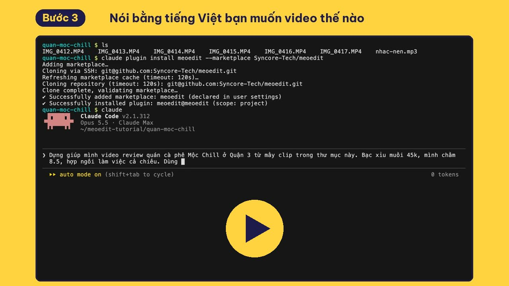
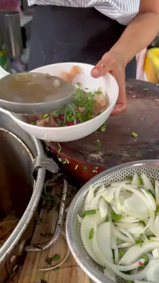
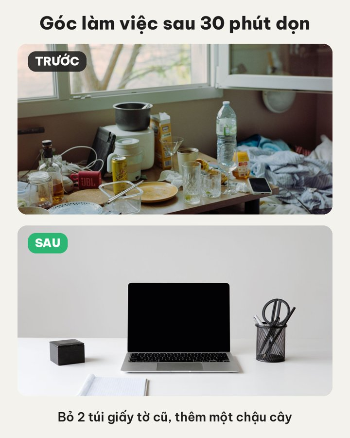
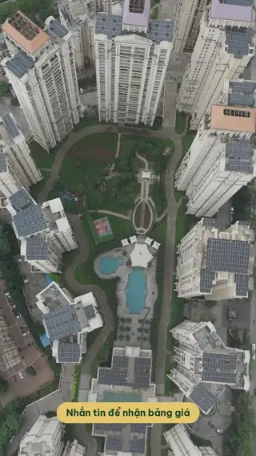
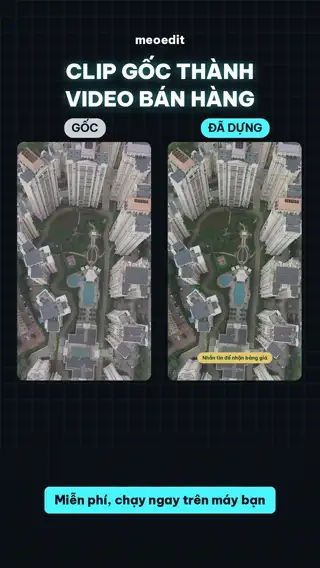
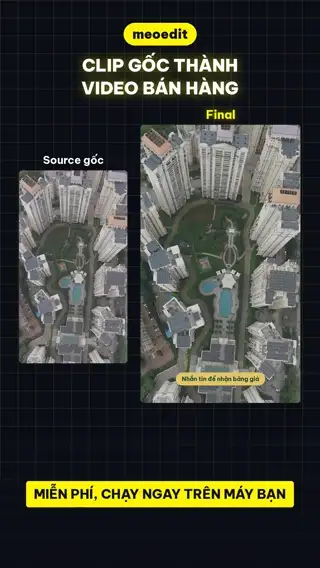
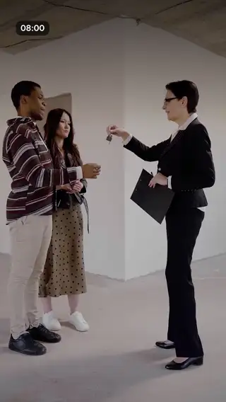
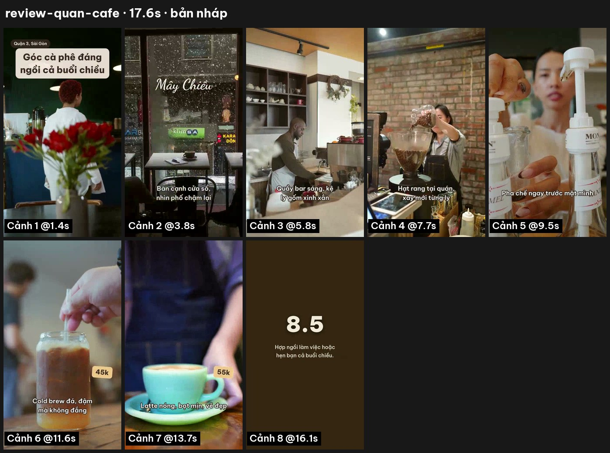

# meoedit 🐱

**Biến agent AI thành editor riêng của bạn: dựng video dọc và thiết kế ảnh từ template, miễn phí, mã nguồn mở, chạy hoàn toàn trên máy bạn.**

Trang giới thiệu: https://meoedit.gaupoit.workers.dev/

Quay bằng điện thoại, đưa thư mục cho agent (Claude Code, Codex, Cursor, Gemini CLI...), chọn template. Agent xem clip, chọn cảnh đẹp, viết chữ, cho bạn xem bản nháp, chờ bạn duyệt rồi mới xuất video 1080x1920.

- **Miễn phí, MIT.** Không tài khoản, không đăng nhập, không trả phí theo template.
- **Riêng tư.** Ảnh, clip, giọng nói không rời khỏi máy bạn.
- **Tiếng Việt chuẩn.** Font có dấu đầy đủ (Be Vietnam Pro, Baloo 2, Dancing Script), câu hỏi và chữ mẫu bằng tiếng Việt.
- **Bạn duyệt trước.** Luôn có bản nháp + ảnh tổng quan từng cảnh trước khi xuất bản cuối.
- **Không cần Remotion hay dịch vụ ngoài.** Chỉ cần ffmpeg và Python.

## Xem hướng dẫn (69 giây)

[](docs/meoedit-huong-dan.mp4)

Cài plugin, gõ một câu tiếng Việt, duyệt bản nháp, nhận video 1080x1920. Quay thẳng từ Claude Code. Video này cũng dựng bằng meoedit (template `huong-dan`).

## Demo

| Review quán cà phê | Vlog du lịch | Thẻ sản phẩm |
|---|---|---|
|  |  |  |
| 8 cảnh, 17.6s, nhạc nền | 7 cảnh, 12.7s, cắt nhanh | 1080x1350 |

| Review quán ăn | Outfit | Mở hộp sản phẩm | Công thức nấu ăn |
|---|---|---|---|
|  |  |  |  |

| Story khuyến mãi | Trước và sau | Ảnh trích dẫn |
|---|---|---|
|  |  |  |

| Giới thiệu dự án BĐS | Trước và sau video | Trước và sau neon | Portfolio dịch vụ | Hậu trường |
|---|---|---|---|---|
|  |  |  |  |  |

Trước khi xuất, agent gửi bạn ảnh tổng quan từng cảnh để duyệt:



Quán, chuyến đi, shop, sản phẩm và giá trong demo là hư cấu; media lấy từ Pexels và nhạc của Kevin MacLeod (CC BY 4.0). Xem [examples/demo/CREDITS.md](examples/demo/CREDITS.md). Tự dựng lại: `examples/demo/fetch-media.sh` rồi chạy plan trong `examples/demo/`.

## Template có sẵn

| Template | Loại | Dùng cho |
|---|---|---|
| `review-quan-cafe` | Video 9:16 | Review quán cà phê, tiệm bánh. Tông nâu kem, chữ mềm, mờ dần |
| `vlog-du-lich` | Video 9:16 | Vlog du lịch, recap chuyến đi. Cắt nhanh, chữ in hoa vàng |
| `review-quan-an` | Video 9:16 | Review quán ăn, đồ ăn đường phố, food tour. Đỏ vàng, nhãn giá nghiêng |
| `outfit-ootd` | Video 9:16 | OOTD, phối đồ, shop thời trang. Chữ nghiêng kiểu tạp chí, nhãn từng món |
| `mo-hop-san-pham` | Video 9:16 | Mở hộp, giới thiệu mỹ phẩm, đồ handmade. Hồng phấn, màn giá và nút đặt hàng |
| `cong-thuc-nau-an` | Video 9:16 | Công thức, mẹo bếp. Màn nguyên liệu, nhãn Bước 1, 2, 3 |
| `gioi-thieu-du-an` | Video 9:16 | Sale bất động sản: tên dự án, vị trí, điểm nổi bật, giá "chỉ từ", nút liên hệ cố định |
| `truoc-sau-video` | Video 9:16 | Hai video chạy cạnh nhau trong khung sáng: bản gốc và bản đã làm. Khoe kết quả edit, sửa nhà |
| `truoc-sau-neon` | Video 9:16 | Trước và sau kiểu team edit BĐS: khung gốc nhỏ, khung kết quả lớn viền vàng neon, dải ưu đãi vàng |
| `portfolio-dich-vu` | Video 9:16 | Studio, team quay dựng khoe sản phẩm. Câu khách hỏi, cắt 1 giây, nhãn loại việc |
| `hau-truong` | Video 9:16 | Hậu trường, một ngày đi làm. Giờ trong ngày, chữ gõ từng ký tự |
| `noi-chuyen-phu-de` | Video 9:16 | Một người nói vào camera: hook trong hộp vàng, phụ đề to bám lời từ file SRT |
| `van-de-giai-phap` | Video 9:16 | TikTok Shop: cái bực mình (nhãn đỏ), sản phẩm xử lý (nhãn xanh), lợi ích, giá, nút mua |
| `so-sanh` | Video 9:16 | So sánh A với B: hai khung chạy song song, tiêu chí hiện lần lượt, nhãn chốt bên thắng |
| `top-danh-sach` | Video 9:16 | Top 3, top 5 quán, địa điểm, sản phẩm. Số thứ tự to, đếm ngược về số 1 |
| `hoi-dap` | Video 9:16 | Mỗi video một câu khách hỏi: câu hỏi gõ trong bong bóng tin nhắn, trả lời, ý chính |
| `thuc-don-quan` | Video 9:16 | Thực đơn quán: tên món, giá vàng, nhãn combo, địa chỉ và giờ mở cửa cố định |
| `gym-bai-tap` | Video 9:16 | Gym, PT: tên bài, số hiệp × số lần, đồng hồ đếm ngược, mẹo tư thế |
| `huong-dan` | Video 16:9 | Hướng dẫn phần mềm, quay màn hình: khung bo góc trên nền vàng, nhãn Bước 1, 2, 3 |
| `the-san-pham` | Ảnh 4:5 | Ảnh bán hàng Facebook, Instagram, Threads, Shopee |
| `story-khuyen-mai` | Ảnh 9:16 | Story flash sale: phần trăm giảm, giá mới, giá cũ, thời hạn |
| `truoc-sau` | Ảnh 4:5 | So sánh trước và sau: dọn nhà, làm tóc, chăm da, sửa chữa |
| `anh-trich-dan` | Ảnh 1:1 | Câu nói hay, lời khách khen trên nền ảnh phủ tối |

## Cài đặt

Cần: Python 3.9+, [ffmpeg](https://ffmpeg.org/download.html), Pillow.

```bash
# macOS (Ubuntu: sudo apt install ffmpeg, Windows: winget install ffmpeg)
brew install ffmpeg
python3 -m pip install --user pillow
```

### Claude Code (khuyên dùng)

Trong Claude Code, gõ:

```
/plugin install meoedit --marketplace Syncore-Tech/meoedit
```

Hoặc chạy trong terminal: `claude plugin install meoedit --marketplace Syncore-Tech/meoedit`.

Claude Code bản cũ hơn 2.1.275 thì cài hai bước:

```
/plugin marketplace add Syncore-Tech/meoedit
/plugin install meoedit@meoedit
```

Cập nhật bản mới: `/plugin marketplace update meoedit`. Gỡ: `/plugin uninstall meoedit@meoedit`.

### Codex, Cursor, Gemini CLI và agent khác

```bash
git clone https://github.com/Syncore-Tech/meoedit.git
cd meoedit
./install.sh
python3 skill/engine/cli.py doctor
```

`install.sh` chép skill vào `~/.claude/skills/meoedit` và `~/.codex/skills/meoedit` nếu có. Với Cursor, Gemini CLI hay agent khác: mở thư mục repo và bảo agent *"đọc skill/SKILL.md rồi làm theo"*.

## Dùng thế nào

Nói với agent:

> Dùng meoedit dựng video review quán cà phê từ thư mục ~/Movies/moc-chill. Nhạc ở ~/Music/lofi.mp3.

Agent sẽ:

1. Hỏi tên quán, món, giá, chấm điểm.
2. Xem nhanh từng clip (ảnh `thumbs.jpg`) để chọn đoạn đẹp.
3. Viết `plan.json`: cảnh nào, cắt từ giây mấy, chữ gì.
4. Xuất bản nháp 540x960 + ảnh tổng quan, rồi **dừng chờ bạn duyệt**.
5. Sửa theo ý bạn, xuất bản cuối 1080x1920, âm thanh chuẩn -14 LUFS.
6. Muốn tự chỉnh tiếp: xuất thành **project CapCut** (đúng font, chữ, vị trí, nhạc), mở CapCut sửa và xuất như bình thường.

Dùng tay không cần agent cũng được:

```bash
python3 skill/engine/cli.py templates
python3 skill/engine/cli.py thumbs clips/*.MOV -o thumbs.jpg
python3 skill/engine/cli.py video plan.json --preview
python3 skill/engine/cli.py video plan.json
python3 skill/engine/cli.py image card.json
python3 skill/engine/cli.py capcut plan.json     # project CapCut để sửa tiếp
```

Định dạng `plan.json` xem trong [skill/SKILL.md](skill/SKILL.md).

## Tự làm template

Một template là một thư mục trong `skill/templates/`:

- `style.json`: khung hình, màu chỉnh video (`grade`, bộ lọc ffmpeg), chuyển cảnh, và các kiểu chữ (`presets`: font, cỡ, màu, viền, hộp nền, vị trí, độ nghiêng), gõ từng ký tự với `typewriter`), lớp nền `shapes` (dải màu, gradient, khung `frame` có phát sáng, lưới `grid`; `"back": true` để nằm dưới video), và `panels` để chia màn hình thành nhiều khung video.
- `TEMPLATE.md`: câu hỏi cho người dùng, cấu trúc cảnh, độ dài chữ. Agent đọc file này.

Sao chép một template có sẵn, đổi tên, sửa màu và chữ, chạy `tests/smoke.sh`. PR template mới rất được hoan nghênh: tin tức, sự kiện, giáo dục...

## Lộ trình

- [ ] Giọng đọc AI tiếng Việt chạy trên máy (tuỳ chọn)
- [ ] Phụ đề tự động từ lời nói (Whisper chạy trên máy)
- [x] Thêm template: review quán ăn, outfit, mở hộp, nấu ăn, ảnh vuông 1:1, ảnh story 9:16
- [x] Thêm template bất động sản: giới thiệu dự án, trước và sau video, portfolio, hậu trường
- [x] Thêm template theo xu hướng TikTok Shop: nói chuyện có phụ đề, vấn đề và giải pháp, so sánh, top, hỏi đáp, thực đơn quán, gym
- [ ] Cắt theo nhịp nhạc tự động
- [x] Xuất project CapCut để sửa tiếp, phụ đề SRT, zoom trong cảnh
- [ ] Chuyển cảnh và hiệu ứng chữ trong project CapCut

## Giấy phép

Mã nguồn: [MIT](LICENSE). Định dạng draft CapCut tham khảo từ [pyJianYingDraft](https://github.com/GuanYixuan/pyJianYingDraft) (Apache 2.0) và [VectCutAPI](https://github.com/sun-guannan/VectCutAPI); meoedit không dùng mã của hai dự án này. CapCut là thương hiệu của ByteDance, meoedit không liên quan. Media demo: xem [CREDITS](examples/demo/CREDITS.md). Font tải từ Google Fonts theo giấy phép SIL Open Font License. meoedit không kèm nhạc; bạn tự chịu trách nhiệm bản quyền nhạc và media đưa vào.

---

**English:** meoedit turns your AI coding agent into a video editor. Agent skills plus a small Python + ffmpeg engine that turn phone footage into vertical videos (TikTok, Reels, Shorts) and product images from templates, entirely on your machine. Vietnamese-first, MIT licensed, no account, no cloud.
